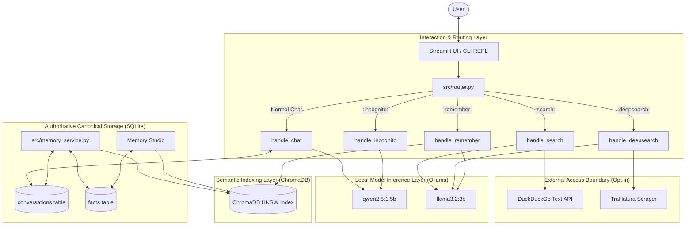

# System Architecture: Localized Agentic Memory Framework

## 1. Architectural Philosophy

The **Localized Agentic Memory Framework** is built around four fundamental engineering principles:
1. **Local-First & Private:** All inference runs on the edge using local models via Ollama. No personal conversational context or stored memories leave the host machine.
2. **Relational Canonical Truth:** SQLite is the authoritative, transactional source of truth for all conversational buffer records, extracted facts, provenance metadata, and superseding relationships. ChromaDB serves as an auxiliary, rebuildable semantic vector index.
3. **Dual-Tier Memory Lifecycle:** Conversations exist first in a short-term ephemeral SQLite buffer. Upon explicit session finalization, an agentic consolidation pipeline extracts atomic facts, executes a 3-layer deduplication engine, and indexes memories for future cross-session recall.
4. **Explicit Network Boundaries:** External web search is an isolated, opt-in feature. When offline modes are selected, zero network requests are dispatched.

---

## 2. High-Level Component Architecture



---

## 3. Module Boundaries & Responsibilities

| Module | Primary Responsibility | Key Functions / Classes |
|---|---|---|
| `src/config.py` | Centralized paths, model configurations, similarity thresholds, and environment variable overrides (`LAM_DATA_DIR`). | `get_runtime_data_dir()`, `get_db_path()`, `get_chroma_dir()` |
| `src/db.py` | SQLite connection factory, WAL pragma setup, automatic schema initialization, and transactional turn helpers. | `init_db()`, `get_db_connection()`, `save_turn()`, `load_history()` |
| `src/models.py` | Ollama client abstraction, structured exception hierarchy, health checks, and mock client for offline testing. | `check_ollama_status()`, `LocalOllamaClient`, `MockOllamaClient` |
| `src/vector_store.py` | ChromaDB vector collection manager, cosine similarity queries, upsert, delete, and idempotent index rebuilds. | `VectorStore`, `query_similar()`, `add_fact()`, `rebuild_from_records()` |
| `src/search.py` | External search service, SSRF private IP validation, retry policy, and per-page download error absorption. | `search_web()`, `search_and_scrape()`, `is_safe_external_url()` |
| `src/prompts.py` | Prompt templates for extraction, summarization, recall, and conflict resolution with anti-injection guardrails. | `get_facts_prompt()`, `get_remember_prompt()`, `get_conflict_resolution_prompt()` |
| `src/memory_service.py` | Complete memory lifecycle: chunked fact extraction, 3-layer deduplication, canonical updates, and Memory Studio operations. | `consolidate_session()`, `resolve_conflict()`, `list_memories()`, `reconcile_and_rebuild()` |
| `src/router.py` | Prefix parsing, empty query validation, context-window building, and handler dispatch. | `route_message()`, `handle_chat()`, `handle_remember()`, `handle_incognito()` |
| `src/demo_data.py` | Non-personal synthetic dataset for academic presentations and viva demonstrations. | `load_synthetic_demo_data()`, `clear_synthetic_demo_data()` |
| `src/app.py` | Streamlit web application providing Chat, Memory Studio, Session logs, System Diagnostics, and Benchmark sandbox. | Multi-tab UI presentation |
| `src/chat.py` | Interactive terminal REPL loop. | Terminal command-line assistant |
| `src/benchmark.py` | Rigorous deduplication evaluation harness with live and offline modes. | `run_benchmark()`, `calculate_metrics()`, `make_chart()` |

---

## 4. Database Schema and State Model

### Canonical Store (`data/schema.sql` + Migrations)

#### `conversations` Table (Ephemeral Turn Buffer)
- `id` INTEGER PRIMARY KEY AUTOINCREMENT
- `session_id` TEXT NOT NULL
- `role` TEXT NOT NULL (`user` or `assistant`)
- `content` TEXT NOT NULL
- `timestamp` DATETIME DEFAULT CURRENT_TIMESTAMP
- `consolidated` INTEGER DEFAULT 0

#### `facts` Table (Authoritative Long-Term Memory)
- `id` INTEGER PRIMARY KEY AUTOINCREMENT
- `fact_text` TEXT NOT NULL
- `fact_hash` TEXT UNIQUE NOT NULL (SHA-256 of normalized text)
- `embedding_id` TEXT (Foreign key pointer to Chroma vector ID)
- `consolidated_date` DATE DEFAULT CURRENT_DATE
- `source_session_id` TEXT (Session where the fact originated)
- `synced_to_chroma` INTEGER DEFAULT 0
- `status` TEXT DEFAULT 'active' (`active`, `superseded`, `deleted`)
- `superseded_by_id` INTEGER DEFAULT NULL (Pointer to replacement fact ID)
- `updated_at` DATETIME DEFAULT CURRENT_TIMESTAMP
- `category` TEXT DEFAULT 'general'

---

## 5. The 3-Layer Semantic Deduplication Pipeline

```text
Candidate Fact (extracted from transcript)
             │
             ▼
   [Layer 1: Exact Hash Match]
             │
     Match found in active facts?
     ├── YES ──> [DUPLICATE] (Skip vector indexing)
     └── NO  ──> Proceed to Layer 2
                     │
                     ▼
        [Layer 2: Vector Cosine Similarity]
        Query ChromaDB HNSW (cosine distance)
        sim = 1.0 - distance
                     │
       Does fact pair contain hard differences?
       (Conflicting numbers, dates, or negation words)
       ├── YES ──> Route directly to Layer 3 (Bypass auto-duplicate)
       └── NO  ──> Evaluate Similarity Band:
                     ├── sim >= 0.90 ──> [AUTO-DUPLICATE] (Skip vector write)
                     ├── sim < 0.70  ──> [AUTO-DISTINCT] (Insert into SQLite & Chroma)
                     └── 0.70 <= sim < 0.90 ──> Ambiguous Band ──> Proceed to Layer 3
                                                                        │
                                                                        ▼
                                                   [Layer 3: Local LLM Conflict Resolution]
                                                   Model: llama3.2:3b
                                                   Prompt: get_conflict_resolution_prompt()
                                                                        │
                                                    Parsed Decision:
                                                    ├── DUPLICATE ──> Skip redundant vector
                                                    ├── UPDATE    ──> Mark old SQLite fact 'superseded',
                                                    │                 superseded_by_id = new_id,
                                                    │                 update Chroma vector
                                                    └── DISTINCT  ──> Insert new active SQLite record,
                                                                      add vector to Chroma
```

---

## 6. Context Window & Memory Retention Policies

1. **Context Window Policy:** Active chat sessions retrieve up to `MAX_HISTORY_TURNS` (default: 10 turns / 20 messages) in chronological order, always appending the current prompt exactly once.
2. **Session Consolidation Boundary:** When a user triggers "End Session & Consolidate Memory", turns marked `consolidated = 0` are extracted in batches of 50. Turns are marked `consolidated = 1` only upon successful fact persistence.
3. **Raw Conversation Retention Policy:** Configurable via UI toggle (`st.session_state.retain_raw_conversations`). When enabled (default), raw turns remain in SQLite for auditability. When disabled, raw turns are deleted only after consolidation succeeds end-to-end.
